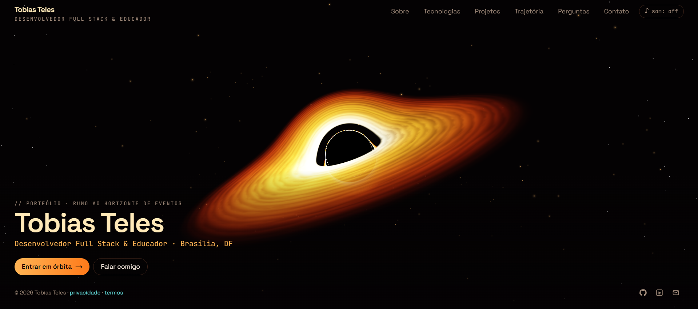
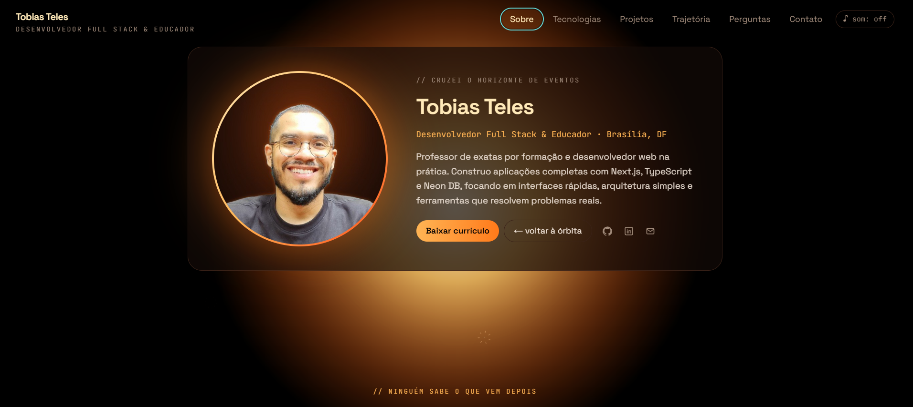
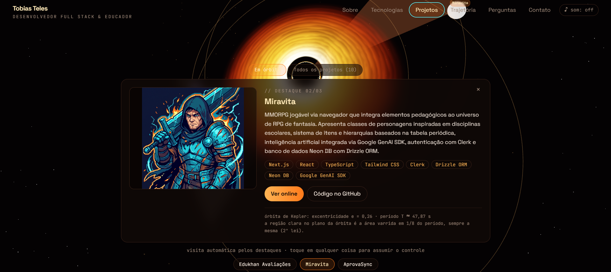
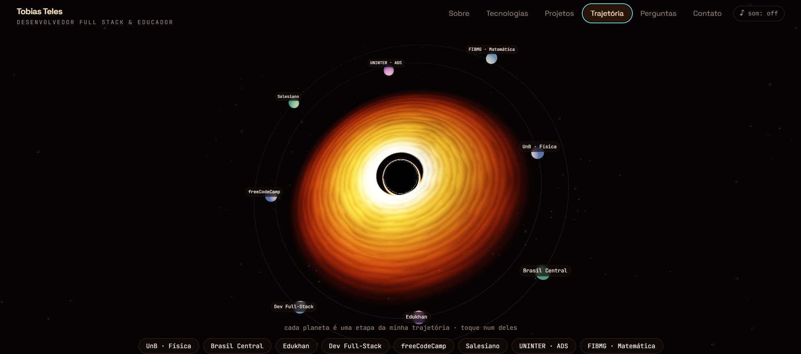

<div align="center">

# 🕳️ Portfólio Buraco Negro

**Um portfólio em 3D onde a página inicial é um buraco negro de verdade: a luz é curvada pela gravidade em tempo real, meus projetos giram em volta como planetas e eu apareço do outro lado do horizonte de eventos.**

[](https://nextjs.org)
[](https://www.typescriptlang.org)
[](https://r3f.docs.pmnd.rs)
[](https://tailwindcss.com)
[](https://orm.drizzle.team)
[](https://neon.tech)

[**🔗 Ver ao vivo**](https://tobiasteles.dev) · [Reportar um bug](../../issues) · [Sugerir uma ideia](../../issues)

<!-- Troque pelo GIF da queda no buraco negro (docs/preview.gif). Se ainda não tiver, apague esta linha. -->


</div>

---

## 🌌 Como ficou

<p align="center">
  
  
</p>
<p align="center">
  
  
</p>

## ✨ Por que um buraco negro?

Sou professor de física e também programo, então quis juntar as duas coisas. A primeira versão deste portfólio era um terminal. Esta troca o menu por uma cena 3D onde cada parte do site é um lugar no espaço, e o 3D usa física de verdade em vez de só enfeite. Por trás é uma aplicação full stack completa, com banco de dados, autenticação e painel administrativo para editar tudo sem mexer no código.

## 🚀 Funcionalidades

**Para quem visita**
- **Buraco negro em tempo real:** lente gravitacional calculada pixel a pixel num shader GLSL, com disco de acreção em rotação diferencial e efeito Doppler. Dá para girar e aproximar
- **Sobre:** a câmera cai dentro do buraco negro, a tela escurece e uma luz laranja nasce do centro, com a minha foto e o texto. Tem botão "pular" e respeita "reduzir movimento"
- **Projetos:** os 3 principais giram como planetas em **órbitas de Kepler** (elipses, mais rápidos perto do buraco, T² ∝ a³), e a imagem de cada projeto vira a superfície do planeta. Os demais ficam numa lista
- **Trajetória:** formações, escolas, Edukhan, certificações e projetos em planetas, num anel separado
- **Tecnologias, Perguntas e Contato:** painéis sobre a cena, com formulário de contato
- **Dilatação do tempo:** ao aproximar o zoom, mostra quanto 1 hora aqui vale lá longe (fórmula da relatividade geral)
- **A luz reage ao mouse** e há um **som ambiente** opcional, gerado na hora pelo WebAudio (começa desligado)
- Menu por hash (`/#projetos`, `/#sobre`...), tela de carregando que "se aproxima" do buraco negro e imagens de compartilhamento (Open Graph/Twitter), `sitemap` e `robots` gerados automaticamente
- Sem WebGL, o site avisa e todo o conteúdo continua acessível. Um resumo em HTML fica escondido para leitores de tela e buscadores

**Para quem administra (`/admin`)**
- Edição de perfil, skills, projetos e FAQ pela interface, sem mexer no código
- **Envio de foto e de imagens de projeto**: o arquivo é reduzido no navegador (JPEG) e salvo no banco. Também aceita link `https://`
- Caixa de entrada com as mensagens do formulário de contato
- Conversor de foto para ASCII com prévia ao vivo, usado como reserva quando não há foto
- Avisos de novas mensagens por **e-mail (Resend)** e **WhatsApp (CallMeBot)**, ambos opcionais

## 🔭 Como a física funciona

Em vez de desenhar uma imagem de buraco negro, o shader dispara um raio de luz para cada pixel e vai curvando o caminho dele passo a passo. Na unidade em que o raio de Schwarzschild vale 1, a aceleração que curva o raio é `-1,5 · h² · r̂ / r⁴`, onde `h` é o momento angular do raio. Se o raio cai em `r < 1`, o pixel fica preto. Se cruza o plano do disco, ele pega a cor do disco naquele ponto. O arco de luz por cima do buraco negro vem dos raios que passam atrás do disco e são dobrados pela gravidade.

- **Disco:** gira com velocidade proporcional a `r^(-3/2)`. O Doppler é uma aproximação simples: o lado que se aproxima brilha mais
- **Kepler:** a posição vem da equação de Kepler resolvida pelo método de Newton, em `src/lib/kepler.ts`. A 2ª lei (áreas iguais em tempos iguais) aparece como o setor claro desenhado em cada órbita
- **Tempo:** para quem fica parado a uma distância `r`, 1 hora vale `1 / √(1 − 1/r)` horas lá longe. Na tela escura da queda, o número continua caindo como encenação, porque a câmera para antes do horizonte
- **Limitações:** o fundo e as estrelas não são curvados pela lente, e o shader é pesado em celulares (por isso usa menos passos de cálculo em telas pequenas)

## 🛠️ Stack

| Camada          | Tecnologias                                                          |
| --------------- | -------------------------------------------------------------------- |
| Framework       | Next.js 15 (App Router, Server Actions) e React 19                   |
| Linguagem       | TypeScript                                                           |
| 3D              | Three.js, React Three Fiber, drei e um shader GLSL próprio           |
| Estilo          | Tailwind CSS 3, Space Grotesk e JetBrains Mono                       |
| Banco de dados  | PostgreSQL serverless no [Neon](https://neon.tech)                   |
| ORM             | Drizzle ORM e Drizzle Kit                                            |
| Autenticação    | JWT (HS256) com `jose` e senhas com `bcryptjs`                       |
| Validação       | Zod                                                                  |
| Deploy          | Vercel                                                               |

## 🔒 Segurança

- Sessão por **JWT em cookie `httpOnly`**, validado no `middleware` e de novo em cada página e Server Action do admin
- Senhas armazenadas com **bcrypt**
- URLs salvas pelo admin aceitam apenas `http(s)`. Imagens enviadas só são aceitas como JPEG, PNG ou WebP, com tamanho limitado, e SVG é recusado
- As imagens saem sempre pelo próprio site (`/foto` e `/imagem/projeto/[id]`), e o endereço buscado vem do banco, nunca da requisição, então não existe um proxy aberto
- Formulário de contato com **validação Zod** e campo **honeypot** contra bots
- Cabeçalhos de segurança (`Content-Security-Policy`, `X-Frame-Options`, `X-Content-Type-Options`, `Referrer-Policy`)

## 📁 Estrutura

```
├── scripts/seed.ts            # cria o admin e o conteúdo de exemplo
├── public/curriculo.pdf       # currículo para download
├── docs/                      # prints e GIF usados neste README
└── src/
    ├── app/
    │   ├── admin/             # painel administrativo (login, perfil, skills, projetos, FAQ, mensagens)
    │   ├── actions/           # Server Actions públicas (contato)
    │   ├── foto/              # foto de perfil enviada pelo admin
    │   ├── imagem/projeto/    # imagens dos projetos (banco ou link https)
    │   └── api/health/        # healthcheck
    ├── components/
    │   ├── universo/          # a cena: buraco negro, órbitas, painéis, som e animação da queda
    │   └── admin/             # formulários, envio de imagem e editor de foto ASCII
    ├── db/                    # schema Drizzle e queries
    └── lib/                   # auth, kepler, física, linha do tempo, imagens, validadores, notificações
```

A cena fica em `src/components/universo/black-hole-scene.tsx` (o shader está lá), e a tela com os painéis em `universo-home.tsx`.

## 🧪 Rodando localmente

**Pré-requisitos:** Node.js 20+, um navegador com WebGL e uma conta gratuita no [Neon](https://neon.tech).

```bash
# 1. Clone e instale
git clone https://github.com/tobiasteles/SEU-REPOSITORIO.git
cd SEU-REPOSITORIO
npm install

# 2. Configure o ambiente
cp .env.example .env.local
# edite DATABASE_URL, AUTH_SECRET, ADMIN_EMAIL e ADMIN_PASSWORD
# para gerar o segredo: openssl rand -base64 32

# 3. Crie as tabelas e o conteúdo de exemplo
npx drizzle-kit push
npm run db:seed

# 4. Inicie
npm run dev
```

- Site: <http://localhost:3000>
- Admin: <http://localhost:3000/admin> (use o e-mail e a senha do `.env.local`)

Depois de entrar no admin, personalize perfil, skills, projetos e FAQ. Os **3 primeiros projetos na ordem do admin** viram os planetas em órbita, e os outros ficam na lista. A linha do tempo da "Trajetória" é editada em `src/lib/timeline.ts`. Para trocar o currículo, substitua `public/curriculo.pdf` ou aponte outro link em `/admin/profile`.

### Variáveis de ambiente

| Variável                              | Obrigatória | Descrição                                          |
| ------------------------------------- | :---------: | -------------------------------------------------- |
| `DATABASE_URL`                        |     ✅      | Connection string do Neon                          |
| `AUTH_SECRET`                         |     ✅      | Segredo para assinar o JWT                         |
| `ADMIN_EMAIL` / `ADMIN_PASSWORD`      |     ✅      | Credenciais do primeiro admin (usadas pelo seed)   |
| `NEXT_PUBLIC_SITE_URL`                |  Produção   | URL pública do site                                |
| `RESEND_API_KEY` / `NOTIFY_EMAIL_TO`  |     ❌      | Aviso de novas mensagens por e-mail                |
| `CALLMEBOT_PHONE` / `CALLMEBOT_APIKEY`|     ❌      | Aviso de novas mensagens por WhatsApp              |

### Scripts úteis

```bash
npm run dev          # servidor de desenvolvimento
npm run build        # build de produção
npm run typecheck    # checagem de tipos
npm run db:generate  # gera migrações SQL
npm run db:migrate   # aplica migrações
npm run db:studio    # interface visual do banco
```

## ☁️ Deploy na Vercel

1. Importe o repositório na [Vercel](https://vercel.com).
2. Cadastre `DATABASE_URL` e `AUTH_SECRET` nas variáveis de ambiente do projeto.
3. Rode `npx drizzle-kit push` e `npm run db:seed` uma vez apontando para o banco de produção.

## 🗺️ Próximos passos

- [ ] Melhorar o desempenho do shader em celulares mais antigos
- [ ] Curvar também as estrelas de fundo com a lente gravitacional
- [ ] Rate limit no formulário de contato (ex.: Upstash Ratelimit)
- [ ] Migrar `middleware.ts` para `proxy.ts` ao atualizar para o Next 16

## 🤝 Contribuindo

Sugestões e correções são bem-vindas. Abra uma [issue](../../issues) para conversar antes de enviar um pull request.


<div align="center">

Se este projeto te ajudou ou inspirou, deixe uma ⭐ no repositório!

</div>
